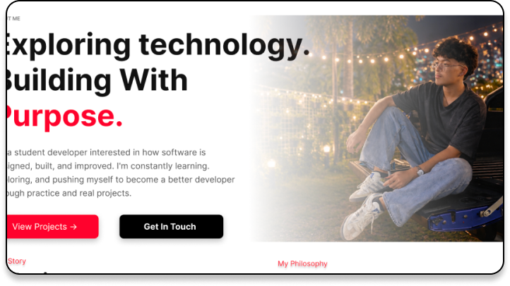

[Marc_Aguilar_Portfolio_README.md](https://github.com/user-attachments/files/33664405/Marc_Aguilar_Portfolio_README.md)
# Marc Aguilar | Developer Portfolio



A responsive, multi-page personal portfolio website built with **HTML, CSS, and vanilla JavaScript**. The site introduces Marc Aguilar, highlights technical skills and projects, and provides a contact experience. It also includes a case study for the Drive Max Auto website project.

## Features

- Responsive layouts for desktop, tablet, and mobile screens
- Separate Home, About, Projects, Skills, Contact, and project case study pages
- Shared CSS styles for consistent page design
- Active-page navigation indicator
- Subtle scroll-reveal effects with support for reduced-motion preferences
- Expandable Skills and Tools sections on smaller screens
- Project screenshots that open in an image lightbox
- Contact form character counter and browser-side form validation
- Contact form that prepares a prefilled email draft in the visitor's default email application

## Pages

| File | Description |
| --- | --- |
| `index.html` | Portfolio landing page |
| `about.html` | Personal introduction and background |
| `projects.html` | Selected projects and project previews |
| `skills.html` | Technical skills and tools |
| `case-study.html` | Drive Max Auto project case study |
| `contact.html` | Contact form and contact information |
| `mobile-nav.html` | Standalone mobile navigation view |

## Built With

- **HTML5** for page structure
- **CSS3** for layout, styling, and responsive design
- **Vanilla JavaScript** for navigation behavior and interactive components

No JavaScript framework or package installation is required.

## Project Structure

```text
.
├── index.html
├── about.html
├── projects.html
├── skills.html
├── case-study.html
├── contact.html
├── mobile-nav.html
├── README.md
├── css/
│   ├── style.css
│   └── interactions.css
├── js/
│   └── main.js
└── assets/
    └── images, icons, and project previews
```

## Run Locally

1. Clone or download this repository.
2. Open the project folder in Visual Studio Code or another code editor.
3. Open `index.html` in your browser, or run the project using the **Live Server** extension in Visual Studio Code.
4. Navigate through the pages using the website's navigation menu.

Keep the existing folder structure and asset filenames unchanged so the image and stylesheet paths continue to work.

## Deploy with GitHub Pages

1. Push the project files to your GitHub repository.
2. Open the repository's **Settings** and select **Pages**.
3. Under **Build and deployment**, choose **Deploy from a branch**.
4. Select your deployment branch (usually `main`) and the root folder (`/`).
5. Save the settings. GitHub Pages will provide the published website URL after deployment finishes.

For the root-folder deployment option to work as described, the HTML files, `css/`, `js/`, and `assets/` folders should be at the repository's top level.

## Contact Form Note

The contact form uses browser-side validation and prepares an email draft through the visitor's email application. It does **not** send messages directly from the website. Automatic form submissions would require a backend or a form-handling service.
